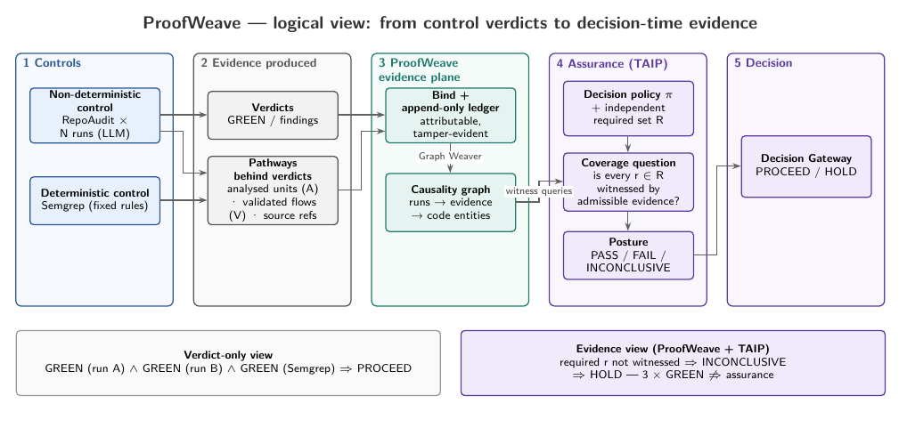
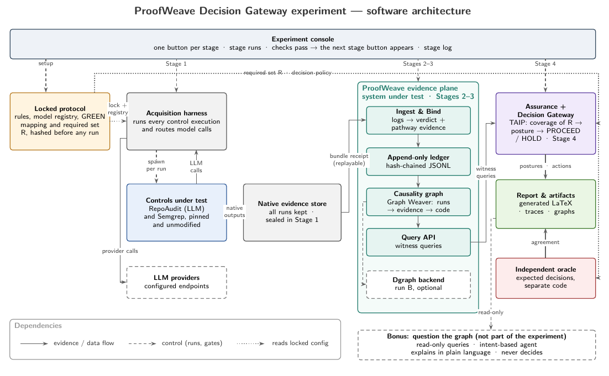
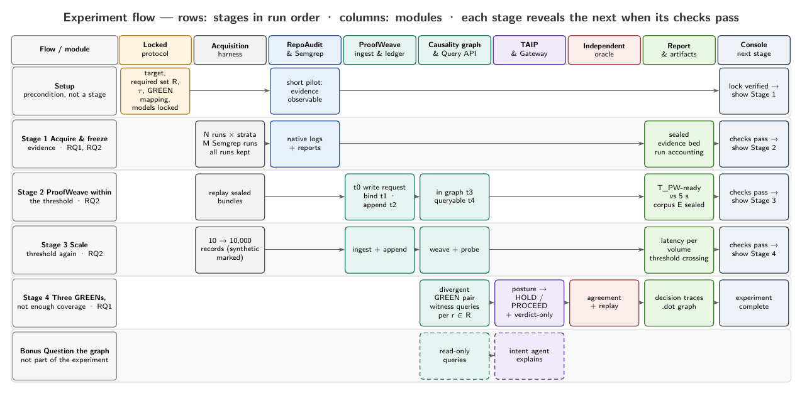

# Experiment design

This document describes what the experiment does, how it is built, and the rules that keep its results trustworthy. The paper's Section "Experiment Design and Execution Protocol" presents the same design.

## 1. The question

A **Decision Gateway** decides whether a software change may proceed, partly from the verdicts of its security controls. When a control is non-deterministic (here the LLM-based auditor **RepoAudit**), two runs on the same code can both return **GREEN** after examining different parts of it. The verdict alone no longer tells the gateway what was checked: *green no longer necessarily means go* (Green Verdict Ambiguity).

**ProofWeave** keeps the evidence behind each verdict: what was analysed, which pathways the None was followed along, and which flows were sent to the path validator. A deterministic assurance layer (**TAIP**) can then ask, at decision time, whether that evidence covers what the decision requires.

- **RQ1 (decision assurance):** can the gateway use the retained evidence to resolve Green Verdict Ambiguity, holding when required coverage is missing even if every verdict is GREEN?
- **RQ2 (evidence readiness):** can ProofWeave make the evidence queryable for posture calculation within a **5 s reference threshold**, measured from the evidence-write request, and how does that change as the evidence grows? Downstream posture computation and gateway enactment are excluded.

## 2. Logical view



## 3. Architecture



| Component | Role |
|---|---|
| Locked protocol (`protocol/`) | Target, required set R, GREEN mapping, τ, models, timing; hashed into `protocol.lock.json` before any campaign run |
| Acquisition harness (`pwexp.stages.stage1_acquire`) | Runs every scheduled control execution as a fresh process; keeps every outcome |
| Model gateway (`pwexp.gateway`) | OpenAI-compatible local endpoint. RepoAudit calls it through the OpenAI SDK's `OPENAI_BASE_URL`; it routes each model to OpenAI or Anthropic with keys held only in memory |
| Controls under test | RepoAudit (pinned, unmodified submodule) and Semgrep CE (pinned version, rules pinned in `protocol/semgrep-rules/`) |
| ProofWeave (`pwexp.proofweave`) | Ingest and Bind → append-only hash-chained ledger → Graph Weaver (in-memory causality graph) → Query API. The system under test for RQ2 |
| TAIP and Decision Gateway (`pwexp.taip`) | Deterministic coverage obligations → posture PASS / FAIL / INCONCLUSIVE → PROCEED / HOLD |
| Independent oracle (`oracle`, separate package) | Derives expected decisions without importing `pwexp` |
| Reporting (`pwexp.report`) | Results page, tables, `.dot` graphs, the paper's generated LaTeX |

## 4. The four stages



| Stage | In plain words | Input | Process | Output | Establishes | RQ |
|---|---|---|---|---|---|---|
| Setup *(precondition)* | Fix the rules before anything runs | Target, required set R (reviewed), τ, GREEN mapping, models | Validate and hash all declarations; short pilot (kept separate) | `protocol.lock.json` | Success can't be redefined after the data exists | — |
| **1 Acquire and freeze evidence** | Run RepoAudit and Semgrep many times on the same code, keep every result, seal it | Locked protocol; pinned controls | N runs per model (fresh processes, seeded order); M Semgrep runs; GREEN mapping; hash and seal | Sealed evidence bed; run accounting | A complete, unfiltered, immutable record of verdicts and the evidence behind them | RQ1, RQ2 |
| **2 ProofWeave within the threshold** | Time how long each sealed result takes to become queryable | Sealed evidence; ProofWeave; 5 s threshold | Replay each bundle; stamp t0 (write request) to t4 (queryable); seal ledger and graph as corpus E | Per-bundle timings; margin to 5 s; corpus E | Whether authentic evidence is ready within the threshold | RQ2 |
| **3 Scale and threshold again** | Repeat as the evidence grows | Sealed evidence; marked synthetic expansion | 10 → 10,000 records with declared repetitions | Latency per volume; crossing point, if any | How readiness scales, and where (if anywhere) it crosses 5 s | RQ2 |
| **4 Three GREENs, not enough coverage** | Show the gateway three GREEN verdicts and check it still holds when coverage is missing | Corpus E; required set R; evidence views | Divergent GREEN pair; witness queries per requirement; posture; gateway action; verdict-only comparison; oracle; replay | Per-view decisions and traces; oracle and replay agreement | Whether the gateway separates sufficient from insufficient coverage behind identical GREENs | RQ1 |
| *Bonus* | Question the graph in plain language | Corpus E; traces | Read-only queries; optional AI explanation | Explanations only | Not part of the experiment | — |

## 5. Rules that keep the results trustworthy

- **GREEN** (RepoAudit): the run completed normally (exit 0, no traceback, native log present, not timed out) **and** reported zero accepted findings. RepoAudit writes its findings file only when it finds something, so a zero-finding run must be confirmed by its own log line `0 bug(s) was/were detected`. Semgrep is GREEN when it completed without errors and with zero findings.
- **Every scheduled run is kept.** Failures and adverse runs are part of the record. Selection of the illustrative divergent pair happens after acquisition, by a fixed rule.
- **RepoAudit is never modified.** It runs at a pinned commit, checked before and after every Stage 1. Model access goes through its own OpenAI SDK configuration.
- **Decisions are deterministic.** No language model decides admissibility, coverage, posture or gateway action. Language models only produce evidence (inside RepoAudit) or explain it (bonus view).
- **The required set R is independent.** It is derived from an independent parse of the target, reviewed by a person and locked before acquisition. It is never derived from RepoAudit's output.
- **The oracle is independent.** It is a separate package (`oracle`) that does not import `pwexp`: it reads the native RepoAudit and Semgrep files, the required set and the target source with its own parsing and coverage rules. Stage 4 checks this automatically.
- **Pathways.** RepoAudit follows a None one function at a time, asking the model at each step where the value goes. ProofWeave reads how each analysis step was reached from the step's own source expression (the literal None: a source; a call to f: returned by f; a parameter: passed in as an argument) and records the step from one function into the next. Runs of one model, with one configuration, on one target end GREEN after exploring different pathways; the report shows them side by side.
- **Required set kinds.** A: a function was analysed; V: a None was followed from one function into another, in order (or a validated chain passes through them); S: a file was scanned by the pinned Semgrep rules. `pwexp required-set draft` proposes items from an `ast` parse of the target; a person reviews them before the lock.
- **Keys are never stored.** API keys are entered per run, kept in memory only and never written to any record, log or output. Every Stage 1 scans its outputs for keys.
- **Stage gating.** A stage starts only when the previous one completed with every check passing. Completion attests correct execution, not a favourable result.
- **Campaign vs pilot.** Only a campaign cycle under the locked protocol, with the declared models, can be published. Pilot cycles never are. The rule for choosing among campaign cycles is declared before any of them runs (`selection_rule` in `protocol.yaml`), and every campaign cycle is reported.

## 6. Records

```
records/
  cycles/<cycle-id>/          local cycles (pilots, your own runs); not committed
    cycle.json                mode, protocol lock, code commit, stage states
    stage-log.jsonl           hash-chained stage completions and failures
    stage1/attempt<k>/        native RepoAudit and Semgrep outputs, manifests, sealed-manifest.json
  published/<cycle-id>/       the master set behind the paper (maintainer only)
```

## 7. Reproducing

Requirement IDs used in the code are listed in [REQUIREMENTS.md](REQUIREMENTS.md). See [REPLICATE.md](../REPLICATE.md) once the master set is published. In short: review the committed results without running anything; re-run Stages 2–4 on the published evidence (Python only, no API key); or create your own evidence set with your own API keys.

## Decision binding (opt-in, DR-23)

Downstream experiments can record each control decision as a bound object: the intent, the decision basis, the decision and the policy in force when it was made. The binding is written when the decision is recorded, from inputs sealed before the control ran.

| Step | What happens |
|---|---|
| Protocol | `decisions:` lists decision groups (control, basis = one RepoAudit run, or one RepoAudit and one Semgrep run, policy, rule `DR-11` or `all-green`, count) and a seed; `policies:` and `manifests:` name their files, which the protocol lock hashes. |
| Stage 1 | The schedule is expanded and shuffled with the seed. For each decision: `decisions/<id>/decision_context.json` and the exact policy bytes are written, then the basis runs execute, then `decision.json` (verdict and per-run GREEN) and the bundle manifest. |
| Stage 2 | After all run bundles, each decision bundle is ingested: intent, policy and decision records, then the binding record. The graph gains `decision`, `intent` and `policy` nodes with `for`, `under`, `by` and `verdict` edges, and a `.dot` decision view per decision. |
| Query | `decision(id)`, `basis(id, kinds)` and `policy_text(record)` resolve the binding through the ledger and recompute the basis root. |

Commands: `pwexp run-stage 1|2 --protocol FILE --records-root DIR` (defaults unchanged); `pwexp import-dev --protocol FILE` writes development decision bundles over the fixture runs (contexts written after the runs, marked as such; never a result).

